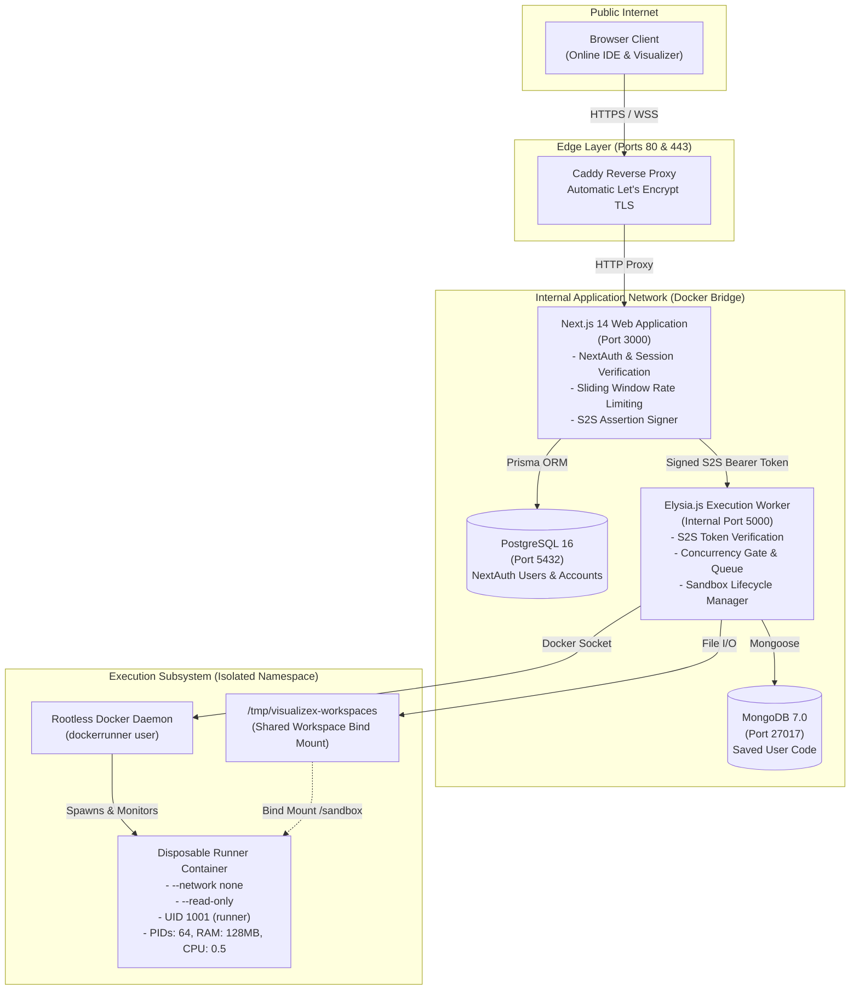
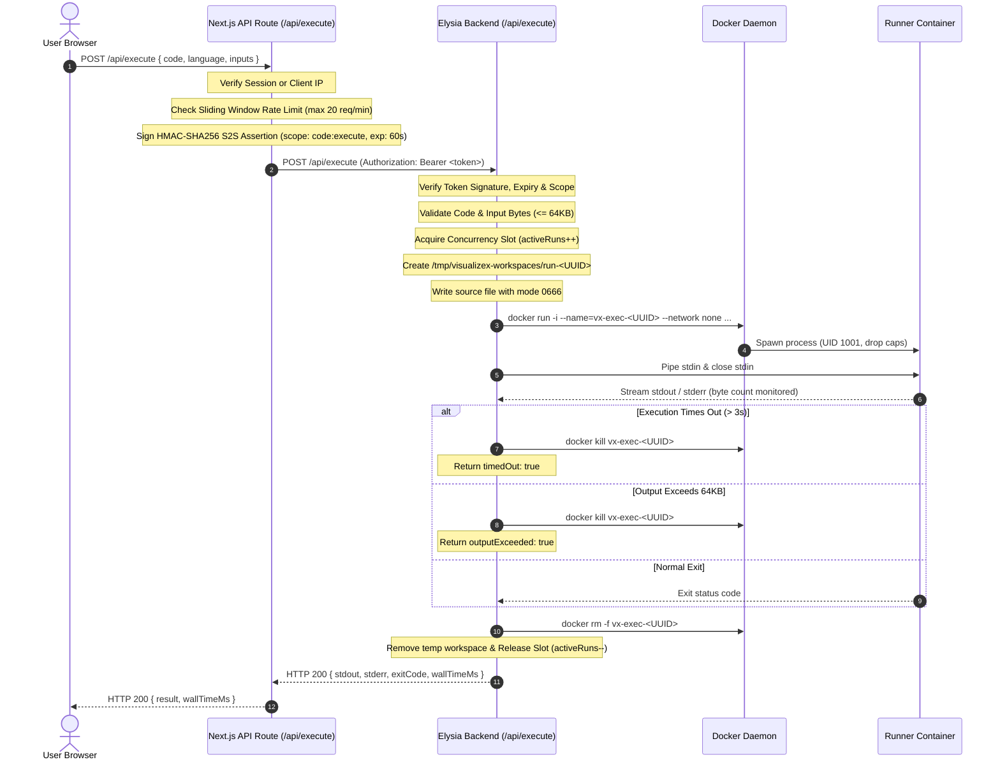

# VisualizeX: System Architecture & Design Specification

**Classification**: Architecture Documentation  
**Version**: 2.0  
**Updated**: November 2026

---

## 1. System Overview

VisualizeX is a full-stack algorithm visualization and cloud code execution platform. It empowers students, competitive programmers, and developers to explore sorting algorithms interactively and write, compile, and execute code in six programming languages directly inside the browser.

---

## 2. Architectural Blueprint

---

## 3. Core Components

### 3.1 Next.js 14 Frontend Application (`app/`)
- **Framework**: Next.js 14 (App Router), React 18, TypeScript, Tailwind CSS.
- **Monaco Editor**: Multi-tab code editor with language-specific starter code and independent tab state preservation.
- **D3.js Visualization Engine**: Visualizes sorting algorithm steps with bar charts, highlighted comparison and swap pointers, and step-accurate playback controls (Start, Pause, Resume, Reset).
- **Security Boundary**: Validates sessions server-side (`getServerSession(authOptions)`), enforces RBAC (`ADMIN` role check), applies sliding-window rate limiting, and signs S2S service assertions.

### 3.2 Elysia.js Execution Worker (`server/`)
- **Runtime**: Bun 1.1+ with Elysia.js.
- **API Security**: Authenticates incoming requests via HMAC-SHA256 tokens signed by Next.js using `INTERNAL_SERVICE_SECRET`.
- **Concurrency Control**: Enforces bounded execution capacity (`MAX_CONCURRENT`) with zero capacity leaks through guaranteed `try/finally` blocks.
- **Container Lifecycle**: Launches, streams, bounds, and terminates disposable Docker containers.

### 3.3 Disposable Runner Environment (`visualizex-runner:latest`)
- **Base OS**: `debian:bookworm-slim`.
- **Supported Languages & Runtimes**:
  - Python 3.11+ (`python3`)
  - Node.js 20 LTS (`node`)
  - C (`gcc -O2`)
  - C++ (`g++ -O2`)
  - Java 17 (`javac` + `java`)
  - C# (Mono 6.8 / C# 6: `mcs` + `mono`)
- **Isolation Boundaries**: Dropped Linux capabilities (`--cap-drop=ALL`), non-root execution (`1001:1001`), disabled networking (`--network none`), read-only root, bounded memory/swap (128 MB), CPU cap (0.5), PID limit (64), and strict execution timeouts (3s).

### 3.4 Databases
- **PostgreSQL 16**: Managed via Prisma ORM for relational authentication models (`User`, `Account`, `Session`, `VerificationToken`).
- **MongoDB 7.0**: Managed via Mongoose for storing user saved code. Utilizes a compound unique index on `{ username: 1, language: 1 }` to enforce one saved code document per user per language.

---

## 4. End-to-End Execution Sequence

---

## 5. Network & Port Security Policy

| Port | Service | Accessibility | Purpose |
|---|---|---|---|
| **80** | Caddy | **Public** | Plaintext HTTP (Redirects to HTTPS) |
| **443** | Caddy | **Public** | Secure HTTPS entry point for all web traffic |
| **22** | OpenSSH | **Restricted / Public** | Administrative VPS access |
| **3000** | Next.js | **Internal Only** | Accessible exclusively by Caddy reverse proxy |
| **5000** | Elysia | **Internal Only** | Accessible exclusively by Next.js within Docker bridge network |
| **5432** | PostgreSQL | **Internal Only** | Accessible exclusively by Next.js |
| **27017** | MongoDB | **Internal Only** | Accessible exclusively by Elysia worker |

